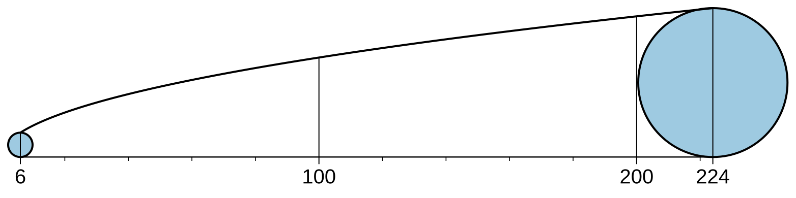
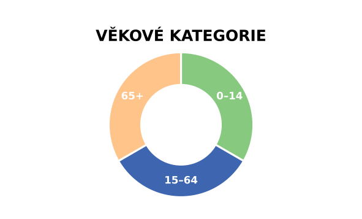
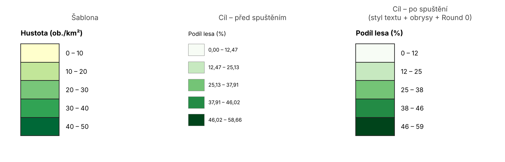

# Toolboxy pro ArcGIS Pro

Sbírka Python toolboxů (`.pyt`) pro **ArcGIS Pro**. U každého toolboxu najdeš, **co dělá**, **jak se ovládá** a **co všechno umí**, včetně ukázek – a odkaz ke **stažení**.

{: .warning }
> **Když něco nefunguje tak, jak má, restartuj ArcGIS Pro.**
> Platí to hlavně **po importu (přidání) toolboxu** nebo po jeho aktualizaci na novou verzi – ArcGIS si načtené nástroje drží v paměti a změny se často projeví až po restartu. Teprve když problém přetrvá i po restartu, nahlas ho.

---

## Než začneš

- [Instalace a import toolboxu](instalace.md) – stažení a přidání toolboxu do projektu
- [Řešení problémů](reseni-problemu.md) – nejčastější potíže a co s nimi

---

## Layout

Nástroje pro tvorbu a úpravu prvků mapové kompozice (legendy, stupnice, grafické prvky).

| Toolbox | Co dělá | Stažení |
|:--|:--|:--|
| [Value-Scale Generator](layout/value-scale.md) | Hodnotová stupnice do legendy mapy s proporcionálními symboly – SVG / PDF nebo rovnou do layoutu ve skutečné velikosti. | [zip](stazeni/ValueScale.zip) |
| [Segmented Legend](layout/segmented-legend.md) | Legenda ve tvaru výsečového / prstencového / polygonového grafu s popisky a nadpisem – editovatelně v layoutu nebo jako obrázek. | [zip](stazeni/SegmentedLegend.zip) |
| [Legend Formatter](layout/legend-formatter.md) | Přenese rozvržení (velikost a rozestupy plošek, pozice popisků a nadpisu, volitelně styl textu) z jedné legendy převedené na grafiku na jinou. | [zip](stazeni/LegendFormatter.zip) |

  
  &nbsp;&nbsp;
  
  &nbsp;&nbsp;
  

**Požadavky:** ArcGIS Pro 3.x. Toolboxy používají jen knihovny, které jsou součástí Python prostředí ArcGIS Pro (`arcpy`, `matplotlib`, standardní knihovna).
