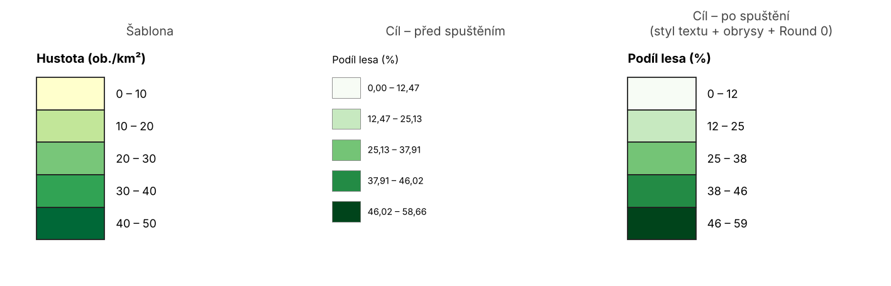

# Legend Formatter

**Toolbox:** `LegendFormatter.pyt` · **Nástroj:** Format Legend From Template · **Skupina:** Layout

[Stáhnout Legend Formatter (.zip)](../stazeni/LegendFormatter.zip){: .btn .btn-primary }
[Zdrojové soubory na GitHubu](https://github.com/fifi1ous/arcgis-pro-toolboxes/tree/main/toolboxy/layout/LegendFormatter){: .btn }

Přenese **rozvržení jedné legendy na jinou**. Pracuje s legendami **převedenými na grafiku** (*Convert To Graphics*) – tedy se skupinou (group element) složenou z polygonových plošek (patch) a textů. Hodí se, když máš v atlasu nebo sadě map víc legend, které mají vypadat stejně: jednu upravíš ručně jako šablonu a ostatní na ni „natáhneš“.

---

## Instalace

Toolbox je jediný soubor `LegendFormatter.pyt`.

1. Stáhni zip tlačítkem nahoře a rozbal ho (ne jen otevři v průzkumníku).
2. V ArcGIS Pro: **Catalog → Toolboxes → Add Toolbox** → vyber `LegendFormatter.pyt`.
3. **Restartuj ArcGIS Pro.**

{: .warning }
> **Po importu toolboxu restartuj ArcGIS Pro** (celý program, ne jen projekt). Totéž platí po aktualizaci na novou verzi. Když něco nefunguje tak, jak má, je restart vždy první krok – viz [Řešení problémů](../reseni-problemu.md).

---

## Co se přenáší

**Vždy:**

- šířka a výška plošek a jejich vertikální rozestup,
- pozice popisků vůči ploškám – např. popisky na **hranicích mezi ploškami** místo u středů,
- pozice nadpisu vůči ploškám,
- zarovnání textu (horizontální / vertikální), aby pozice odpovídaly šabloně.

**Volitelně:**

- **styl textu** nadpisu a popisků (písmo, velikost, barva, halo, stín, …) – po skupinách,
- **obrysy plošek** (stroke vrstvy symbolu),
- **přeformátování čísel** v popiscích (zaokrouhlení / oříznutí na N desetinných míst).

**Nikdy se nemění:**

- **výplň plošek** (barvy cílové legendy zůstávají),
- **texty** popisků (kromě volitelného formátu čísel),
- **poloha** cílové legendy – zachová se levý horní roh sloupce plošek.

---

## Příprava legend

1. V layoutu vlož legendu klasicky a nastav ji.
2. Pravým tlačítkem → **Convert To Graphics**. Vznikne skupina prvků (název skupiny uvidíš v panelu Contents).
3. Jednu legendu dolaď ručně – to bude **šablona**.

Nástroj sám rozpozná:
- **plošky** = polygonové grafické prvky ve skupině (seřazené shora dolů),
- **nadpis** = text, který leží zřetelně nad první ploškou,
- **popisky** = ostatní texty (seřazené shora dolů a párované podle pořadí).

---

## Ovládání

| Parametr | Kategorie | Popis |
|---|---|---|
| Template layout | – | Layout se šablonou. |
| Template legend (group element) | – | Skupina-šablona (seznam se naplní po výběru layoutu). |
| Target layout | – | Layout s cílovou legendou – může být stejný i jiný než šablona. |
| Target legend (group element) | – | Skupina, která se upraví. Nesmí být totožná se šablonou. |
| Copy text style (title + labels) | Optional styling | Zkopírovat styl textu ze šablony. |
| Text style parts to copy | Optional styling | Které části stylu kopírovat (aktivní po zaškrtnutí předchozího). |
| Copy patch outlines | Optional styling | Převzít obrysy plošek ze šablony; výplň zůstává. |
| Label numbers | Label text | `Keep` (beze změny), `Round`, `Truncate`. |
| Decimal places | Label text | Počet desetinných míst pro Round / Truncate. |

### Části stylu textu

| Volba | Co obsahuje |
|---|---|
| Font | rodina, řez, velikost písmen (case), podtržení, přeškrtnutí, kapitálky |
| Size | velikost písma |
| Colour and fill effects | barva a výplň textu |
| Halo | velikost a symbol hala |
| Shadow | barva a posun stínu |
| Background / callout | pozadí / bublina textu |
| Spacing and other effects | prostrkání, kerning, řádkování, rotace znaků, odsazení… |
| Inline formatting tags | tagy `<CLR>`, `<FNT>`, `<BOL>` … na začátku a konci textu šablony se obalí kolem textu cíle |

### Formát čísel

Čísla v popiscích se najdou automaticky (desetinná tečka i čárka); formátovací tagy se nemění. Desetinná čárka zůstane čárkou.

| Režim | `12,47 – 25,13` při 0 des. místech | při 1 des. místě |
|---|---|---|
| Keep | `12,47 – 25,13` | `12,47 – 25,13` |
| Round | `12 – 25` | `12,5 – 25,1` |
| Truncate | `12 – 25` | `12,4 – 25,1` |

---

## Jak to funguje uvnitř

1. Načte definici (CIM) obou layoutů a najde skupiny podle názvu.
2. Ze šablony změří medián šířky a výšky plošek a rozestup („pitch“) mezi nimi; převede je mezi jednotkami stránek, pokud mají layouty jiné jednotky.
3. Pozici každého popisku šablony uloží jako **relativní pozici v násobcích rozestupu** – např. 0 = horní hrana první plošky, 1 = hranice mezi 1. a 2. ploškou.
4. Plošky cíle přestaví na obdélníky nové velikosti od zachovaného levého horního rohu.
5. Popisky a nadpis cíle přesune přes `arcpy.mp` (se skutečnými rozměry textu). Pokud to nejde, použije záložní přesun přímo v CIM a vypíše varování.

Má-li cíl **víc popisků než šablona**, pozice dalších popisků se dopočítají (extrapolují) se stejným krokem a nástroj na to upozorní.

---

## Poznámky a omezení

- Funguje jen s legendou **převedenou na grafiku** – ne s živým prvkem Legend.
- Popisky se párují podle pořadí shora dolů, ne podle textu.
- Pokud nadpis existuje jen v jedné z legend, nepřesouvá se.
- Nástroj nejde spouštět na pozadí (pracuje s aktuálním projektem).
- Před spuštěním je dobré projekt uložit nebo si legendu zkopírovat – nástroj přepisuje cílovou skupinu.
