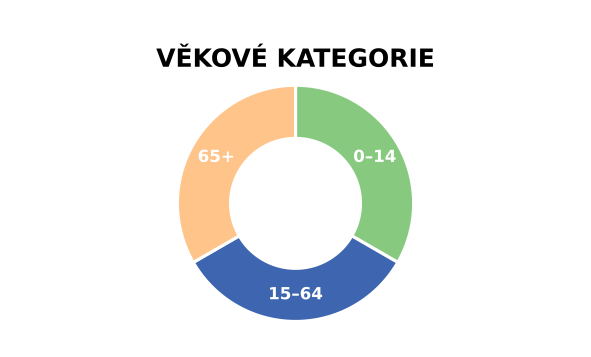
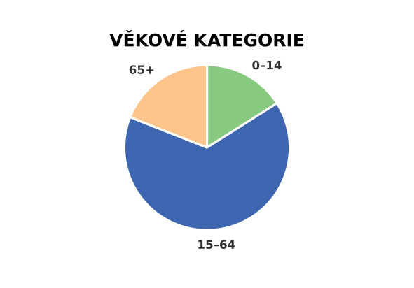
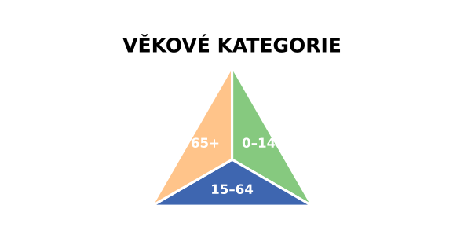
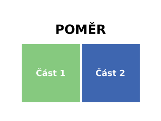
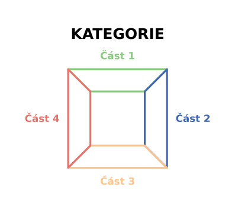
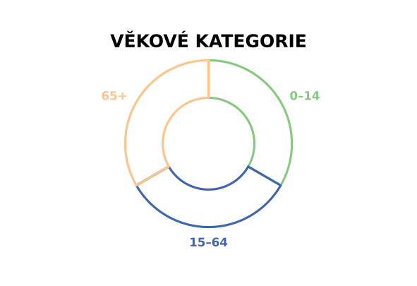

# Segmented Legend

**Toolbox:** `SegmentedLegend.pyt` · **Nástroj:** Create Segmented Legend · **Skupina:** Layout

[Stáhnout Segmented Legend (.zip)](../stazeni/SegmentedLegend.zip){: .btn .btn-primary }
[Zdrojové soubory na GitHubu](https://github.com/fifi1ous/arcgis-pro-toolboxes/tree/main/toolboxy/layout/SegmentedLegend){: .btn }

Vytvoří legendu ve tvaru **výsečového grafu, prstence (donut) nebo rozděleného polygonu** – s nadpisem a popisky jednotlivých částí. Hodí se např. pro legendu strukturních kartodiagramů (věkové kategorie, podíly…).

Výstup:

- **do layoutu** – jako **editovatelné** polygony a textové prvky, seskupené do jedné skupiny (texty lze později přepsat ručně),
- nebo **do souboru** SVG / PNG / JPG / PDF (v SVG zůstává text textem),
- nebo **obojí najednou** (*Also save as image file*).

Vyžaduje ArcGIS Pro 3.0+.

---

## Instalace

Toolbox je jediný soubor `SegmentedLegend.pyt`.

1. Stáhni zip tlačítkem nahoře a rozbal ho (ne jen otevři v průzkumníku).
2. V ArcGIS Pro: **Catalog → Toolboxes → Add Toolbox** → vyber `SegmentedLegend.pyt`.
3. **Restartuj ArcGIS Pro.**

{: .warning }
> **Po importu toolboxu restartuj ArcGIS Pro** (celý program, ne jen projekt). Totéž platí po aktualizaci na novou verzi. Když něco nefunguje tak, jak má, je restart vždy první krok – viz [Řešení problémů](../reseni-problemu.md).

---

## Tvary a styly

| Tvar | Popis |
|---|---|
| **Circle (pie)** | Kruh rozdělený na výseče. |
| **Donut** | Prstenec rozdělený na výseče; velikost díry nastavuje *Hole size*. |
| **Polygon** | 2 části = obdélník rozdělený na dvě; 3 = trojúhelník, 4 = čtverec, 5 = pětiúhelník … (jedna část na stranu). |
| **Polygon ring** | Totéž s dírou uprostřed. |

| Styl | Popis |
|---|---|
| **Full** | Plné výplně, mezi částmi tenká oddělovací čára (barva *Separator colour*). |
| **Outline** | Jen obrysy částí v jejich barvě. |

| | | |
|---|---|---|
|  |  |  |
| Circle (pie), váhy 16 / 65 / 19, popisky *Outside* | Polygon, 3 části | Polygon, 2 části |
|  |  | |
| Polygon ring, 4 části, *Outline* | Donut, *Outline*, popisky *Outside* | |

---

## Ovládání

### Části legendy (Divisions)

Tabulka **Divisions** má tři sloupce:

| Sloupec | Popis |
|---|---|
| Label | Text popisku části. |
| Colour (hex) | Barva, např. `#3E66B0`. |
| Weight | Váha = velikost výseče u kruhu / prstence (relativně k součtu). U polygonů se 3+ částmi se váhy ignorují (každá strana = jedna část); u 2dílného obdélníku posouvají dělicí čáru. |

- **Number of divisions** a tabulka jsou propojené – změna počtu přidá/odebere řádky (nové dostanou barvu z výchozí palety), přidání řádku v tabulce upraví počet (1–24).
- **Pick colour from colour picker for division…** – vyber část ze seznamu a otevře se systémový výběr barvy Windows; vybraná barva se zapíše do tabulky.

### Parametry

#### Obecné

| Parametr | Výchozí | Popis |
|---|---|---|
| Output to | Layout | `Layout`, `SVG`, `PNG`, `JPG`, `PDF`. |
| Also save as image file | ne | Jen pro *Layout*: zároveň uloží kopii do souboru ve stejné fyzické velikosti. |
| Output file | – | Cesta k souboru; formát podle přípony. |
| Main label | VĚKOVÉ KATEGORIE | Nadpis legendy (prázdné = bez nadpisu). |

#### Layout

| Parametr | Výchozí | Popis |
|---|---|---|
| Layout | první layout | Cílový layout. |
| Element (group) name | SegmentedLegend | Název skupiny; prvky se jmenují `<název>_part1`, `<název>_label1`, `<název>_title`. |
| Overwrite existing element | ano | Při opakovaném spuštění smaže starou legendu se stejným názvem a vytvoří novou **na stejném místě**. |
| Centre X / Y | – | Střed legendy v jednotkách stránky. Prázdné = pozice staré legendy, jinak střed stránky. |

#### Shape

| Parametr | Výchozí | Popis |
|---|---|---|
| Shape | Donut | Viz tabulka tvarů. |
| Style | Full | Full / Outline. |
| Size | 40 | Průměr (kruh), průměr opsané kružnice (polygon), šířka (2dílný obdélník). V jednotkách stránky, pro soubory v mm. |
| Hole size | 0.55 | Velikost díry jako podíl vnější velikosti (0,05–0,95) – jen Donut / Polygon ring. |
| Rotation | 0 | Otočení ve stupních po směru hodin. |
| Order of divisions | Clockwise | Pořadí částí – po / proti směru hodin, začíná nahoře. |
| Line width (pt) | 1.5 | Oddělovač (Full) / obrys (Outline). |
| Separator colour | `#FFFFFF` | Barva oddělovací čáry (jen Full). |

#### Text

| Parametr | Výchozí | Popis |
|---|---|---|
| Part label position | Inside | `Inside`, `Outside` (vně, zarovnané podle strany), `None`. |
| Main label position | Above | `Above`, `Below`, `None`. |
| Font family | Arial | Písmo. |
| Main label size / Part label size (pt) | 12 / 8 | Velikosti písma. |
| Main label bold / Part labels bold | ano / ano | Tučné písmo. |
| Main label colour | `#000000` | Barva nadpisu. |
| Part label colour | automaticky | Prázdné = bílá uvnitř plných částí, barva části u Outline, tmavě šedá jinak. |

#### File export

| Parametr | Výchozí | Popis |
|---|---|---|
| Resolution (DPI) | 300 | Pro PNG / JPG. |
| Transparent background | ano | Pro PNG / SVG / PDF (JPG je vždy s bílým pozadím). |

---

## Typický postup

1. Spusť nástroj, nastav **Number of divisions** a v tabulce vyplň popisky a barvy (ideálně stejné jako v mapě).
2. Vyber tvar a styl, nastav velikost.
3. *Output to* = **Layout**, vyber layout a spusť.
4. Legendu v layoutu přesuň, kam potřebuješ. Při dalším spuštění se stejným názvem se legenda přegeneruje na stejném místě.
5. Potřebuješ-li ji i jinde (prezentace, web), zaškrtni *Also save as image file*.

---

## Poznámky a omezení

- Polygonové tvary potřebují alespoň 2 části.
- Nástroj nejde spouštět na pozadí (pracuje s aktuálním projektem `CURRENT`).
- Pokud se prvky nepodaří seskupit, zůstanou v layoutu jednotlivě a nástroj vypíše varování.
- Výběr barvy přes dialog funguje jen ve Windows.
