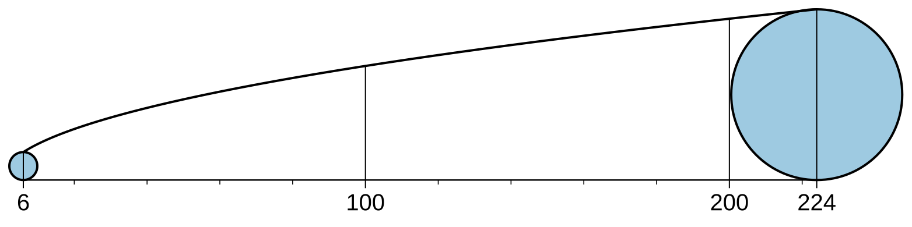
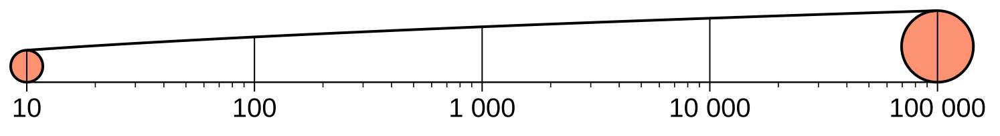
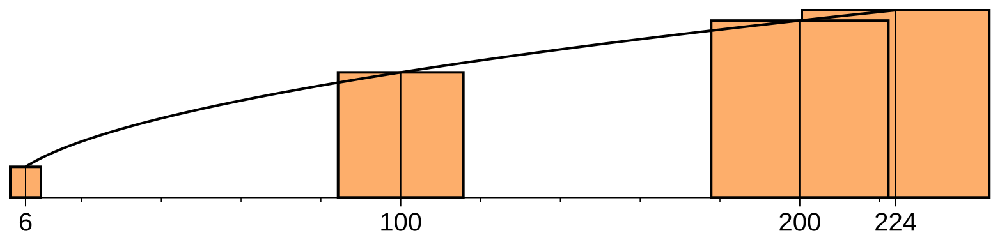
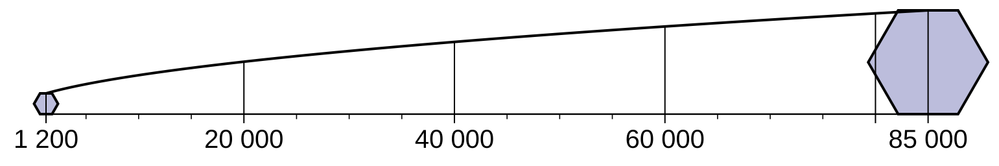
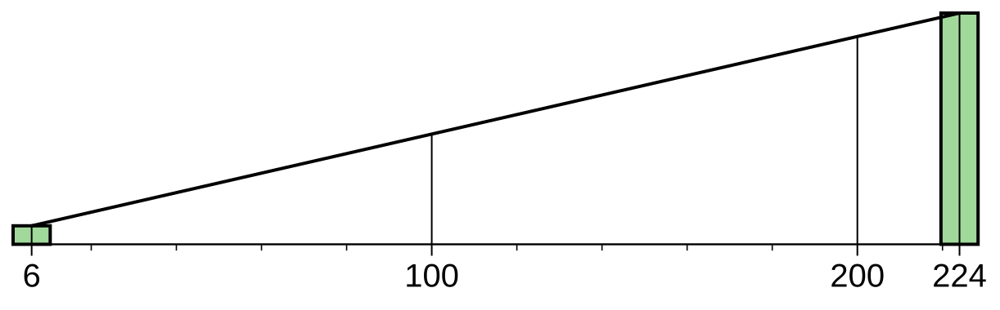
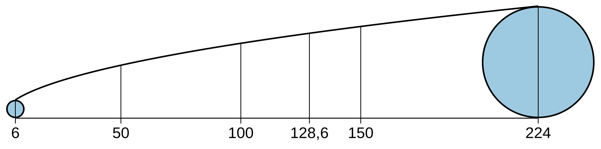

# Value-Scale Generator

**Toolbox:** `ValueScale.pyt` · **Nástroj:** Generate Value Scale · **Skupina:** Layout

[Stáhnout Value-Scale Generator (.zip)](../stazeni/ValueScale.zip){: .btn .btn-primary }
[Zdrojové soubory na GitHubu](https://github.com/fifi1ous/arcgis-pro-toolboxes/tree/main/toolboxy/layout/ValueScale){: .btn }

Vytvoří **hodnotovou stupnici** (value scale) pro legendu mapy s proporcionálními (velikostně odstupňovanými) symboly. Stupnice ukazuje, jak velikost symbolu odpovídá hodnotě jevu – nejmenší a největší symbol, křivku velikosti mezi nimi a dělení s popisky.



Výstup může být:

- **SVG** a/nebo **PDF** soubor,
- **obrázek vložený přímo do layoutu** – ve **skutečné velikosti**, takže symboly ve stupnici odpovídají symbolům v mapě (nic se neškáluje ručně).

Nástroj je portem webového generátoru M. Holuba a R. Barvíře (Univerzita Palackého v Olomouci):
> Barvíř, R., Holub, M., Vondráková, A. (2025): *Proportional Symbol Maps: Value-Scale Types, Online Value-Scale Generator and User Perspectives.* ISPRS Int. J. Geo-Inf. 14(9), 340. [doi:10.3390/ijgi14090340](https://doi.org/10.3390/ijgi14090340)

---

## Instalace

Stáhni **celou složku** (zip) – toolbox potřebuje všechny soubory **ve stejné složce**:

| Soubor | Účel |
|---|---|
| `ValueScale.pyt` | Python toolbox pro ArcGIS Pro (dialog nástroje) |
| `value_scale.py` | Jádro – geometrie stupnice, zápis SVG a PDF (jen standardní knihovna, lze použít i mimo ArcGIS) |
| `value_scale_layout.py` | Práce s ArcGIS Pro – čtení rozsahu z dat/symbologie, vložení do layoutu |
| `value_scale_tool.py` | *Volitelné* – skript pro klasický „script tool“ (New Script), pokud nechceš `.pyt` |

1. Stáhni zip tlačítkem nahoře a rozbal ho (ne jen otevři v průzkumníku).
2. V ArcGIS Pro: **Catalog → Toolboxes → Add Toolbox** → vyber `ValueScale.pyt`.
3. **Restartuj ArcGIS Pro.**

{: .warning }
> **Po importu toolboxu restartuj ArcGIS Pro** (celý program, ne jen projekt). Totéž platí po aktualizaci na novou verzi. Když něco nefunguje tak, jak má, je restart vždy první krok – viz [Řešení problémů](../reseni-problemu.md).

{: .note }
> Pomocné moduly `value_scale*.py` se při každém spuštění znovu načítají, takže drobné úpravy v nich se projeví i bez restartu. Po importu nebo výměně celého toolboxu ale restartuj.

---

## Jak to funguje

- **Osa x** je lineární v hodnotě jevu. *Délka stupnice* = vzdálenost středů nejmenšího a největšího symbolu.
- **Osa y** = výška symbolu *h(v)*:
  - **plošné symboly** (kruh, čtverec, trojúhelník, pětiúhelník, šestiúhelník, vlastní SVG): **plocha** úměrná hodnotě → `h = h_min · √(v / v_min)` (křivka),
  - **sloupcové symboly** (sloupec, „apex“ – trojúhelníková špička): **výška** úměrná hodnotě → `h = h_min · v / v_min` (přímka).
- Pokud je zadaná **maximální výška symbolu** (odpovídá zaškrtnutému *Maximum size* v Symbology), symboly se interpolují mezi `h_min` a `h_max` – buď podle **plochy** (výchozí, jako ArcGIS Pro), nebo podle **výšky**.
- **Flanneryho kompenzace** se nepoužívá (stejně jako v původním nástroji) – pokud ji má vrstva zapnutou, nástroj upozorní.

---

## Ovládání

### Zdroj hodnot (min / max)

Minimum a maximum hodnoty jevu se dá získat třemi způsoby – parametr **Value Source**:

| Value Source | Co se stane |
|---|---|
| **Layer symbology** | Přečte se renderer vrstvy symbolizované *Proportional Symbols* – rozsah dat, který spočítal ArcGIS Pro, i minimální velikost symbolu. Nejjistější cesta k tomu, aby stupnice odpovídala mapě. |
| **Field** | Min/max se spočítá z číselného atributu vrstvy. |
| **Expression** | Min/max z výrazu – Python ve stylu Field Calculatoru (`math.log10(!POP!)`, `!POP! / !AREA!`) nebo jednoduchý Arcade (`$feature.POP`, `Log($feature.POP)`). |

Hodnoty se **doplní automaticky do polí Minimum / Maximum** hned po výběru vrstvy a pole. Respektuje se výběr (selection) i definition query. Hodnoty ≤ 0 nebo nespočitatelné (např. log 0) se přeskočí a nástroj vypíše jejich počet.

Min/max lze také zadat ručně bez vrstvy (výchozí 6 – 224).

### Parametry

#### Základní

| Parametr | Výchozí | Popis |
|---|---|---|
| Input Features | – | Vrstva, ze které se čte rozsah (volitelné). |
| Value Source | Field | Layer symbology / Field / Expression – viz výše. |
| Value Field | – | Číselné pole (při *Field*). |
| Value Expression | – | Výraz (při *Expression*). |
| Minimum / Maximum Phenomenon Value | 6 / 224 | Rozsah hodnot; musí platit 0 < min < max. |
| Symbol Shape | circle | `circle`, `square`, `triangle`, `pentagon`, `hexagon`, `column`, `apex`, `custom`. |
| Custom Symbol (SVG) | – | Vlastní symbol pro tvar `custom` (max. 1 MB). |
| Minimum Symbol Height | 12 | Výška nejmenšího symbolu. |
| Maximum Symbol Height | – | Volitelně výška největšího symbolu (jako *Maximum size* v Symbology). |
| Sizes Between Minimum and Maximum | Area | Interpolace mezi min a max: podle plochy nebo výšky. |
| Column \| Apex-Base Width | 5 | Šířka sloupce / základny apexu (jen `column`, `apex`). |
| Symbol-Size Unit | Points | Jednotka velikosti symbolů: Points, Millimeters, Centimeters, Inches. |
| Scalebar Length (mm) | 120 | Délka stupnice. |
| Font Size (pt) | 10 | Velikost popisků; `0` = bez popisků. |
| Typographic Style | European | Formát čísel: `12 345,6` / `12,345.6` / `12345.6`. |

#### Legend labels – vlastní popisky

Na stupnici lze tisknout jiná čísla než data – např. když data jsou uložená jako logaritmy.

| Parametr | Popis |
|---|---|
| Label Minimum / Label Maximum | Číslo vytištěné u minima / maxima (zadávají se oba, nebo žádný). |
| Label Mapping | `Linear`, nebo `Logarithmic` – data = a + b·log(popisek). Dělení se pak generuje po dekádách (10, 100, 1 000 …) jako na logaritmickém pravítku. |



#### Optional settings

| Parametr | Výchozí | Popis |
|---|---|---|
| User-Defined Divisions | automaticky | Vlastní hlavní dělení oddělená středníkem, např. `50; 100; 128.6` (v jednotkách popisků). |
| Number of Subdivisions | automaticky | Počet dílků mezi hlavními děleními; `0` = žádné. |
| Draw a Symbol at Every Division | ne | Kromě min a max nakreslí symbol i u každého hlavního dělení. |
| Fill Colour | bez výplně | Hex barva výplně, např. `#9ecae1`. |
| Symbol Stroke (pt) | 1 | Tloušťka obrysu symbolu; `0` = bez obrysu. |
| Symbol Stroke Colour | `#000000` | Barva obrysu. |
| Symbol Outline Offset (pt) | 0 | Posun obrysu od hrany symbolu: `+` dovnitř, `−` ven (jako efekt *Offset* v Pro). Velikost symbolu se počítá z neposunutého tvaru. |
| Curve Line Width (pt) | 1.0 | Tloušťka křivky. |
| Division Line Width (pt) | 0.5 | Tloušťka dělení; základní čára 1,2×, dílky 0,8×. |

#### Výstup

| Parametr | Popis |
|---|---|
| Output SVG | Cesta k výstupnímu SVG. |
| Output PDF | Cesta k výstupnímu PDF (vektorové, bez externích knihoven). |
| Insert into Layout | Název layoutu, do kterého se stupnice vloží. |
| Position X / Y | Pozice levého horního rohu (jednotky stránky). Prázdné = levý dolní roh stránky s 5% okrajem. |
| Picture Element Name | Název prvku v layoutu (výchozí `Value scale`). |
| Replace Existing Element… | Při opakovaném spuštění se prvek se stejným názvem **nahradí na místě** (zachová pozici). |

Je potřeba vyplnit **alespoň jeden** výstup – layout, SVG nebo PDF.

---

## Ukázky

| | |
|---|---|
|  <br> Čtverce, *Draw a Symbol at Every Division* |  <br> Šestiúhelníky, min 8 pt / max 40 pt, popisky s mezerou jako oddělovačem tisíců |
|  <br> Sloupce (`column`) – výška roste lineárně, proto přímka |  <br> Vlastní dělení `50; 100; 128.6; 150`, bez dílků, obrys posunutý dovnitř |

---

## Typický postup (aby stupnice seděla s mapou)

1. Symbolizuj vrstvu jako **Proportional Symbols**, v Symbology nastav *Unit* = **Unknown** (velikost v bodech na stránce).
2. Spusť nástroj, **Value Source = Layer symbology**, vyber vrstvu – doplní se min, max i minimální velikost symbolu.
3. Pokud máš v Symbology zaškrtnuté *Maximum size*, zadej stejnou hodnotu do **Maximum Symbol Height**.
4. Vyber **layout** a spusť. Stupnice se vloží ve skutečné velikosti.
5. Ve zprávách nástroje je kontrolní údaj, např. *„value 115 → 33,4 pt“* – porovnej s prvkem této hodnoty v mapě.

### Upozornění, která nástroj hlídá

- **Referenční měřítko mapy ≠ měřítko mapového rámu** – ArcGIS pak symboly v mapě zvětšuje/zmenšuje a stupnice by neseděla. Nástroj vypíše, jaké měřítko nastavit, nebo čím vynásobit minimální výšku.
- Symboly v **reálných jednotkách** (metry…), **visual variables** (velikostní proměnná), **normalizace**, **Flannery** – vypíše varování.
- Popisky dělení, které by se překrývaly, se vynechají (min a max se popisují vždy) a nástroj vypíše, které.

---

## Použití mimo dialog nástroje

### Příkazová řádka (bez ArcGIS)

`value_scale.py` funguje samostatně v jakémkoli Pythonu 3:

```bash
python value_scale.py --min 6 --max 224 -o scale.svg -o scale.pdf
python value_scale.py --min 6 --max 224 --shape hexagon --min-size 4 --unit mm --fill "#9ecae1"
python value_scale.py --help
```

### Python okno v ArcGIS Pro

```python
import sys; sys.path.append(r"C:\cesta\ke\slozce")
import value_scale_layout as vsl

# min/max z atributu, vloží do layoutu "Layout"
vsl.add_value_scale(layer="Cities", field="POP",
                    symbol_shape="circle", min_symbol_size=4, symbol_unit="mm",
                    scalebar_length=80, layout="Layout")

# pevný rozsah, aktivní layout, výchozí pozice
vsl.add_value_scale(value_min=6, value_max=224)
```

### Jako knihovna

```python
from value_scale import ScaleConfig, generate_svg
svg = generate_svg(ScaleConfig(value_min=6, value_max=224, fill_colour="#9ecae1"))
```

---

## Omezení

- Pro PDF s vlastním SVG symbolem, který používá CSS třídy, `<use>`, gradienty apod., je potřeba `cairosvg` nebo `svglib` + `reportlab`; jinak použij SVG výstup.
- *Outline offset* není podporován pro vlastní SVG symboly.
- Popisky ve stupnici používají písmo Arial.
